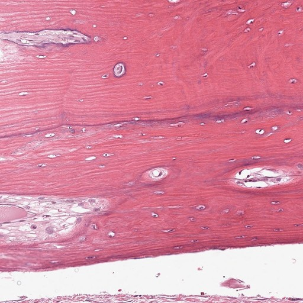
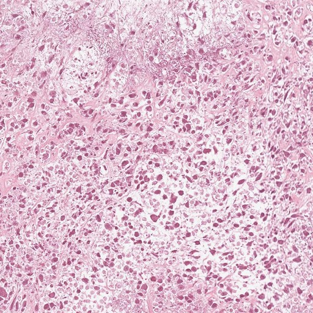
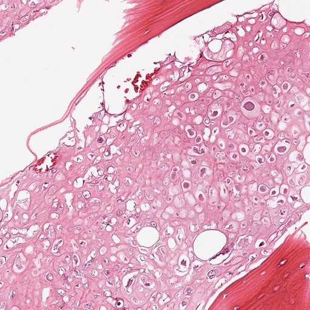
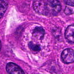
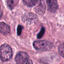

# Clinical retrieval audit

GRAFT explains each prediction with the diagnostic rules it retrieves from the clinical knowledge base
(PGSM) and with how much the knowledge path is trusted (UGKF gate). This page lists, for every class,
the rule GRAFT retrieves most often, together with a dataset image that shows that hallmark.

- **Top-1 Ret.:** share of test cases whose first retrieved rule belongs to the true class.
- **Knowledge Gate:** mean target-class gate value, with the peak routing share in brackets (UBC-OCEAN,
  MIDOG 2025), or the share of the text path in the fused representation (Osteosarcoma).
- **Example image:** a test-split image of that class in which the hallmark is visible, selected by
  inspection to illustrate the rule.

## TCIA Osteosarcoma

| Class | Example image | Most frequently retrieved hallmark | Top-1 Ret. (%) | Knowledge Gate |
|---|---|---|---|---|
| Non-Tumor (NT) |  | Mature lamellar bone with regular osteocytes and quiescent osteoblasts lining resting bone surfaces. | 91.2 | 46.8% |
| Non-Viable Tumor (NVT) |  | Nuclear pyknosis, fragmented cellular debris, and acellular hyalinized stroma from chemotherapy-induced necrosis. | 95.2 | 47.0% |
| Viable Tumor (VT) |  | Neoplastic osteoclast-like multinucleated giant cells and hyperchromatic bizarre nuclei infiltrating chondroid stroma. | 95.5 | 61.4% |

What the images show: parallel lamellae with evenly spaced osteocytes in lacunae and a smooth, thinly lined
bone surface (NT, tile Case-3-A17-14482-34987); a sheet of ghost cells, pyknotic nuclei and granular debris without viable tumour (NVT, tile Case-3-A16-29058-10941);
atypical, enlarged hyperchromatic tumour cells in a chondroid matrix next to bone (VT, tile Case-48-P5-C18-36407-15875).

## MIDOG 2025, Track 2

| Class | Example image | Most frequently retrieved hallmark | Top-1 Ret. (%) | Knowledge Gate |
|---|---|---|---|---|
| Atypical mitotic figure (AMF) |  | Ring-shaped metaphase with chromosomes arranged around a hollow center. | 88.2 | 0.042 |
| Normal mitotic figure (NMF) |  | Telophase with two equal-sized daughter chromatin masses at opposite ends of the cell. | 93.1 | 0.081 |

What the images show: chromatin arranged in a ring around a pale, hollow centre (AMF, crop 9856.png);
two equal, dense daughter chromatin masses at opposite poles of one elongated cell (NMF, crop 9497.png).
All three experts gave both crops the shown label.

## UBC-OCEAN

| Class | Most frequently retrieved hallmark | Top-1 Ret. (%) | Knowledge Gate |
|---|---|---|---|
| Clear Cell (CC) | Solid sheets of cells with abundant clear cytoplasm and distinct cell membranes; dense hyalinized stroma separating tubulocystic patterns. | 72.3 | 0.606 (peak 83.4%) |
| Endometrioid (EC) | Confluent glandular architecture with smooth luminal borders and minimal stroma; pseudostratified columnar epithelium resembling endometrium. | 59.7 | 0.543 (peak 84.0%) |
| High-Grade Serous (HGSC) | Abundant apoptosis and tumor-infiltrating lymphocytes; solid, endometrioid, and transitional (SET) patterns with marked nuclear atypia. | 78.3 | 0.663 (peak 83.3%) |
| Low-Grade Serous (LGSC) | Slit-like fenestrations in dense fibrous stroma; micropapillary architectural patterns with frequent concentric psammoma bodies. | 47.6 | 0.444 (peak 83.7%) |
| Mucinous (MC) | Ruptured mucinous cysts eliciting a prominent histiocytic response; infiltrative glandular patterns with intracellular mucin. | 70.7 | 0.564 (peak 51.0%) |

UBC-OCEAN images are not reproduced here because the competition rules do not allow redistribution of the
competition data; they are available from the [Kaggle competition page](https://www.kaggle.com/competitions/UBC-OCEAN).

## Image sources

- TCIA Osteosarcoma: Leavey et al., 2019, DOI [10.7937/tcia.2019.bvhjhdas](https://doi.org/10.7937/tcia.2019.bvhjhdas),
  used under the TCIA Data Usage Policy; tiles resized to 512 × 512 px.
- MIDOG 2025 Atypical Training Set: Zenodo DOI [10.5281/zenodo.15188326](https://doi.org/10.5281/zenodo.15188326),
  CC BY-NC 4.0; crops shown at their original 128 × 128 px (displayed enlarged).
