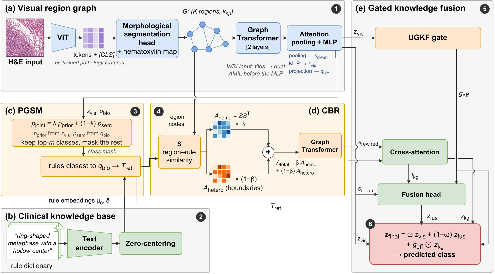

# GRAFT — Graph-Guided Rule Alignment For Tissue

Supplementary material for the ESANN paper
**"Read the Rules and Rewire the Graph: Graph-Guided Rule Alignment for Tissue Classification"** (A. Palai, A. Dasgupta, R. Sarkar — Jadavpur University).

GRAFT groups vision-transformer tokens into learned tissue regions, retrieves diagnostic rules from a
zero-centred clinical dictionary restricted to visually plausible classes (**PGSM**), rewires the
region graph with homophilic and tumour–stroma boundary edges (**CBR**), and admits the
textual knowledge only where the visual classifier is uncertain (**UGKF**).

## Architecture

(a) visual region graph, (b) zero-centred clinical knowledge base, (c) Prior-Guided Semantic Masking (PGSM), (d) Concept–Boundary Rewiring (CBR), (e) Uncertainty-Gated Knowledge Fusion (UGKF). Vector version: [figures/graft_architecture.pdf](figures/graft_architecture.pdf).

## Dataset splits
| Dataset | Protocol | Train : Validation : Test |
|---|---|---|
| UBC-OCEAN | 5-fold stratified cross-validation (seed 42) | 80 : – : 20 per fold |
| TCIA Osteosarcoma | fixed split | 61 : 22 : 17 |
| MIDOG 2025, Track 2 | slide-grouped stratified split (seed 42) | 63 : 16 : 21 |

## Contents
| File | What it contains |
|---|---|
| [DATASETS_AND_SETUP.md](DATASETS_AND_SETUP.md) | Dataset descriptions, splits, preprocessing, training details, hyperparameter values |
| [ABLATIONS.md](ABLATIONS.md) | Component ablations and hyperparameter sensitivity on UBC-OCEAN and Osteosarcoma |
| [RESULTS.md](RESULTS.md) | Confusion matrices |
| [CLINICAL_RETRIEVAL_AUDIT.md](CLINICAL_RETRIEVAL_AUDIT.md) | Per-class retrieved clinical hallmark shown next to an example image, with retrieval accuracy and knowledge-gate values |

## Further related work
- M.Y. Lu et al. Data-efficient and weakly supervised computational pathology on whole-slide images (CLAM). *Nature Biomedical Engineering*, 5:555–570, 2021.
- Z. Shao et al. TransMIL: Transformer based correlated multiple instance learning for whole slide image classification. *NeurIPS*, 2021.
- M.Y. Lu et al. A visual-language foundation model for computational pathology (CONCH). *Nature Medicine*, 30:863–874, 2024.
- X. Zhang et al. Knowledge-enhanced visual-language pre-training on chest radiology images. *Nature Communications*, 14:4542, 2023.
- A. Radford et al. Learning transferable visual models from natural language supervision (CLIP). *ICML*, 2021.
- P. Lewis et al. Retrieval-augmented generation for knowledge-intensive NLP tasks. *NeurIPS*, 2020.
- Y. Shi et al. Masked label prediction: Unified message passing model for semi-supervised classification. *IJCAI*, 2021.
